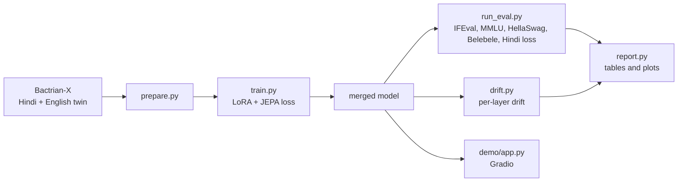

# BhashaJEPA

**Teaching a small English LLM Hindi without making it forget English.**

Hashcode 14.0 · Track 02 (LLM Training) · PES University · Team Sci-Py

BhashaJEPA is a pre-registered experiment, not just a model. It tests whether a JEPA-style
"stay close to your English self" loss can stop English forgetting when Llama-3.2-1B-Instruct is
fine-tuned on Hindi, and it compares the loss head-to-head against the standard fixes.

---

## The problem

Fine-tuning an English instruct model on a new language can damage the English it already had.
The usual fix, replaying English data, needs old training data or English answers, which are
often unavailable. The CFT paper (Aggarwal et al., arXiv 2410.16006) shows this forgetting tracks
representation drift and asks for methods that regularise representation geometry.

## The idea

A Hindi instruction and its English original are two views of the same meaning. While the model
learns Hindi, we ask it to **predict** the representation that the frozen original model gives
the English version of the same instruction.

```
L = L_NTP(y | x)  +  λ · ( 1 − cos( Pred(Enc_θ(x)),  sg[ Enc_φ(e) ] ) )

x  Hindi instruction     y  Hindi response     e  English twin of x
θ  model + LoRA          φ  original model (adapter off)     sg  stop-gradient
```

- Needs only translated **instructions**, never English answers.
- `Pred` appends `k` special `<|predictor_k|>` tokens and reuses the model's own weights
  (idea from [LLM-JEPA](https://arxiv.org/abs/2509.14252)).
- The English anchor comes from the original model, cached once before training, so no second
  model sits on the GPU during training.



## Methods compared

All methods use the same base model, the same 3,000 Hindi training rows in the same order, and
the same evaluation.

| ID | Method | What it tests |
|---|---|---|
| P1 | Original Llama-3.2-1B-Instruct | English ceiling, Hindi floor |
| B1 | Naive Hindi fine-tuning | Size of forgetting |
| B2 | English replay (300 English rows) | Known fix that needs English answers |
| B4 | Plain alignment (k = 0, no predictor) | Is prediction needed, or is alignment enough? |
| J1 | **BhashaJEPA** (k = 1, frozen English anchor) | Main method |
| J2 | Shared / moving target (implemented, **not run**) | Is the frozen anchor needed? |

## Results (honest summary)

Setup: Llama-3.2-1B-Instruct, LoRA rank 64, 1 epoch, 3,000 Hindi rows, accuracy in %, Hindi loss
on 300 held-out Hindi answers (lower is better). B1 and J1 are means of 3 seeds. Every other
row is a single seed.

| Model | IFEval | MMLU | HellaSwag | English avg | Hindi loss | Belebele Hindi | Belebele Kannada |
|---|---|---|---|---|---|---|---|
| P1 original | 46.6 | 48.0 | 55.4 | 50.0 | 1.432 | 35.8 | 30.1 |
| B1 naive (3 seeds) | 46.2 | 46.8 | 55.8 | 49.6 | 1.139 | 34.3 | 28.6 |
| B2 English replay | 42.5 | 47.0 | 56.4 | 48.6 | 1.137 | 33.7 | 28.8 |
| B4 plain alignment | 44.2 | 47.0 | 54.7 | 48.6 | 1.147 | 35.9 | 29.2 |
| **J1 BhashaJEPA (3 seeds)** | 46.5 | 47.1 | 54.6 | 49.4 | 1.145 | 34.3 | 27.0 |

Harder settings, added after LoRA showed almost no forgetting (single seed each):

| Setting | Model | IFEval | English avg | Hindi loss |
|---|---|---|---|---|
| LoRA, 3 epochs | B1 / J1 | 45.5 / 43.6 | 49.6 / 48.0 | 1.197 / 1.188 |
| LoRA, 5x learning rate | B1 | 40.7 | 45.0 | 1.201 |
| Full fine-tuning | B1 | 37.0 | 45.6 | 1.187 |
| Full fine-tuning, embeddings frozen | B1 / J1 | 34.9 / 32.7 | 44.8 / 44.5 | 1.192 / 1.190 |

Mean per-layer representation drift on 200 English probe prompts (seed 0, lower = English
internals moved less): B1 0.75, B2 0.74, B4 0.69, **J1 0.65**.

### What we found

1. **Hindi is learned.** Hindi loss drops from 1.43 to about 1.14 for every method.
2. **LoRA at 1B barely forgets English.** IFEval moves from 46.6 to about 46.2, which is inside
   noise. Forgetting becomes clear only with full fine-tuning (about 10 IFEval points lost).
3. **BhashaJEPA did not stop forgetting where it exists.** Under full fine-tuning J1 lost about
   as much English as naive B1 (single seed).
4. **BhashaJEPA does reduce representation drift** (about 13% below B1 in seed 0), but with so
   little behavioural forgetting the link between drift and performance cannot be tested here.
5. **Belebele is near chance** (about 25% for 4 choices) at this scale, so it cannot show Hindi
   or Kannada comprehension gains.

### Pre-registered hypotheses

| Hypothesis | Status |
|---|---|
| H1: retention vs naive CFT | Not supported. LoRA shows no measurable forgetting; under full fine-tuning J1 did not help (1 seed). |
| H2: prediction beats plain alignment | Inconclusive. J1 has 3 seeds, B4 has 1, so the seed-range rule cannot be applied. |
| H3: frozen anchor beats shared target | Not run. J2 is implemented but untrained. |
| H4: drift mechanism | Partial. J1 has lower drift, but the drift-to-forgetting link is untestable at this scale. |
| H5: transfer to unseen Kannada | Not observed. Kannada stays near chance. |

The `R_ifeval` / `R_EA` columns in `results/*/results.csv` divide by a gap that is close to zero,
so they are unstable. Do not quote them.

## Repository layout

```
data/prepare.py        Bactrian-X Hindi + English join by id, filters, fixed id lists, DATA_HASH
train/train.py         One trainer for B1, B2, B4, J1, J2 (LoRA or --full fine-tuning)
eval/run_eval.py       IFEval, MMLU, HellaSwag, Belebele (hi, kn) via lm-eval, plus Hindi metrics
eval/hindi_eval.py     Hindi loss and Devanagari-script rate
eval/drift.py          Per-layer covariance drift on English probes
eval/merge.py          Rebuild a merged model from a saved adapter
analysis/report.py     Results table, IFEval confidence intervals, Pareto plot, training curves
demo/app.py            Gradio demo: P1 vs B1 vs J1 side by side
run_all.sh             Main pipeline on 2 GPUs (B1 x3 seeds, J1 x3 seeds, B2, B4)
run_stress.sh          3-epoch LoRA stress test
run_lr.sh              High-learning-rate LoRA test
run_full.sh, run_full2.sh   Full fine-tuning runs
results/main, results/stress   Metrics, drift JSON and tables
```

## Reproduce

The scripts were run on Kaggle with 2 x T4 and use `/kaggle/working` and `/tmp` paths.

```bash
git clone https://github.com/VishalBasapure/Hashcode && cd Hashcode

# environment (versions the trainer was tested against)
pip install transformers==4.55.2 peft==0.17.0 datasets accelerate matplotlib
python -m venv /tmp/ev && /tmp/ev/bin/pip install "lm_eval[ifeval]"   # separate venv for lm-eval

# model (accept the Llama 3.2 licence on Hugging Face first)
huggingface-cli download meta-llama/Llama-3.2-1B-Instruct --local-dir /tmp/llama

python data/prepare.py --tokenizer /tmp/llama --out data
python train/train.py --method J1 --seed 0 --model /tmp/llama --smoke   # checks + 20 steps
python eval/run_eval.py --model /tmp/llama --name P1                    # baseline scores
bash run_all.sh                                                         # full comparison
bash run_stress.sh                                                      # optional extras
python analysis/report.py
```

`train.py` runs sanity checks before training: label masking, anchor-cache equality, the token
the loss reads, and gradient flow from the JEPA term. Runs never overwrite an existing run
folder.

## Demo

```bash
pip install gradio peft transformers accelerate deep-translator
python demo/app.py --base <path to Llama-3.2-1B-Instruct> \
    --b1 models/B1_s0 --j1 models/J1_s0 --results results/main --share
```

The demo answers one prompt with the original model, naive fine-tuning and BhashaJEPA. It also
shows a Hindi-to-English "meaning match" score and a tab on the forgetting ladder.

## Limitations

- One base model (1B), LoRA mostly, 3,000 Hindi rows, machine-translated data.
- Only B1 and J1 have 3 seeds. B2, B4 and the harder settings are single runs.
- Differences under about 4 IFEval points are within noise (541 prompts).
- Hindi generation from a 1B model remains weak, and Kannada output is not usable.
- Safety behaviour after multilingual fine-tuning was not evaluated.

## Related work and credits

- Aggarwal et al., *Exploring Continual Fine-Tuning for Enhancing Language Ability in LLMs*, arXiv 2410.16006
- Huang, LeCun, Balestriero, *LLM-JEPA*, arXiv 2509.14252 (trainer reuses its predictor-token and last-token ideas, Apache-2.0)
- Liu and Niehues (ACL 2025), TRepLiNa (2025, adapter-off anchor idea), OSCD (2026): closest prior work
- Data: [Bactrian-X](https://huggingface.co/datasets/MBZUAI/Bactrian-X) (CC BY-NC 4.0, non-commercial research use)
- Model: Meta Llama 3.2 (Llama 3.2 Community License)
- Benchmarks: IFEval, MMLU, HellaSwag, Belebele via lm-evaluation-harness

## Team

Team Sci-Py, PES University: Vishal, N Abhilash, Prithwin.